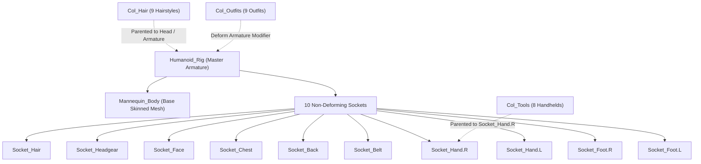

# Hearthwild 3D-to-Pixel-Art Blender Workflow & Modular Rig System

This directory contains the master modular 3D humanoid rig, modular socket system, and headless batch rendering pipeline for baking character models into zero-drift, 8-directional 2D pixel-art sprite sheets conforming to Hearthwild's strict visual contracts.

---

## 1. Directory Structure

```text
art/source/blender/
├── README.md                      # This specification and workflow manual
├── build_modular_rig.py           # Procedural master rig, mannequin, and attachment generator
├── render_modular_cast.py         # Modular cast batch renderer (8 facings x idle/walk)
├── render_pixel_sprites.py        # Standalone model renderer (single-file models)
├── models/
│   ├── humanoid_modular_base.blend  # Master humanoid rig with swappable modular attachments
│   ├── player_aqualia.blend         # Authored standalone model for Player Aqualia
│   └── rivallie.blend               # Authored standalone model for Rivallie creature
└── renders_modular/               # Output directory for modular cast batch renders
    ├── player_aqualia/            # 8 facings x 6 idle + 8 walk frames
    ├── npcs/
    │   ├── neris/                 # Master Fishmonger (hair, fishmonger apron, fishing net)
    │   ├── reed/                  # Master Reedweaver (reed cap, poncho, reed bundle)
    │   ├── willa/                 # Canal Cook (chef kerchief, apron, ladle)
    │   ├── oren/                  # Runic Stonemason (chisel, sash, stone hammer)
    │   ├── lark/                  # Canal Ferryman (ferry cap, vest, ferry oar)
    │   ├── dara/                  # Waterkeeper (flowing cowl, robe, water phial)
    │   ├── finn/                  # Wetland Scout (hood, tunic, scout staff)
    │   └── vulkan/                # Master Armorer (spiky top, heavy apron, forge hammer)
```

---

## 2. Master Modular Rig & Socket Architecture

The master modular base (`humanoid_modular_base.blend`) is organized into dedicated Blender collections to enable zero-runtime-overhead swappable gear authoring:



### 2.1 Bone Hierarchy & Sockets

The armature contains **19 deform bones** and **10 non-deforming equipment sockets**:

- **Root & Torso**: `Root` $\rightarrow$ `Pelvis` $\rightarrow$ `Spine` $\rightarrow$ `Chest` $\rightarrow$ `Neck` $\rightarrow$ `Head`
- **Arms**: `Chest` $\rightarrow$ `UpperArm.{L,R}` $\rightarrow$ `Forearm.{L,R}` $\rightarrow$ `Hand.{L,R}`
- **Legs**: `Pelvis` $\rightarrow$ `Thigh.{L,R}` $\rightarrow$ `Shin.{L,R}` $\rightarrow$ `Foot.{L,R}`
- **Sockets (Non-Deforming)**:
  - `Socket_Hair`: Head tail $(0, -0.04, 1.48)$
  - `Socket_Headgear`: Head tail $(0, 0, 1.54)$
  - `Socket_Face`: Head center $(0, -0.15, 1.34)$
  - `Socket_Chest`: Chest center $(0, -0.14, 1.04)$
  - `Socket_Back`: Chest dorsal $(0, 0.14, 1.08)$
  - `Socket_Belt`: Pelvis center $(0, -0.14, 0.78)$
  - `Socket_Hand.R` / `Socket_Hand.L`: Hand tail $(\pm 0.46, -0.02, 0.70)$
  - `Socket_Foot.R` / `Socket_Foot.L`: Foot base $(\pm 0.16, 0.04, 0.0)$

### 2.2 Deformation Strategy

- **Fitted Garments** (`Col_Outfits`): Must use an **Armature modifier** with vertex groups matching the skeleton (`Chest`, `Spine`, `Pelvis`, `Thigh.L`, `Thigh.R`). This guarantees seamless deformation during walking and breathing with zero clipping or offset drift.
- **Rigid Accessories & Tools** (`Col_Tools`): Parented directly to the socket bone (`parent_type = 'BONE'`, e.g., `Socket_Hand.R`). Their geometry local origin $(0, 0, 0)$ is placed exactly at the grip point to prevent pendulum swinging during limb rotation.

---

## 3. Projection & Anchor Contracts

All pixel-art sprites rendered for humanoids must conform to the following camera and canvas contract:

| Metric | Specification | Rationale |
| :--- | :--- | :--- |
| **Canvas Dimensions** | $96 \times 144\text{ px}$ | Standard human vertical framing |
| **Ground Anchor** | $(48, 132)$ | World origin $(0, 0, 0)$ maps to pixel $(48, 132)$ |
| **Camera Type** | Orthographic | Eliminates perspective distortion across angles |
| **Camera Pitch** | $20.0^\circ$ | Hearthwild standard elevation angle |
| **Orthographic Scale** | $2.80$ | Preserves proportions with $\ge 2\text{px}$ margin on all borders |
| **Camera Y-Shift** | $60.0 / 144.0$ ($0.41667$) | Exactly maps $(0, 0, 0)$ to pixel row $132$ |
| **Shading** | Workbench Studio + Cavity + Outline | Stylized rim outlines (`rgb(23, 28, 38)`) without anti-aliasing blur |

### 8-Directional Facings

The renderer samples 8 rotation angles around the Z-axis:

| Code | Facing Name | Compass Direction | Blender Rig Z-Rotation |
| :--- | :--- | :--- | :--- |
| `s` | South | Forward / Down | $0^\circ$ |
| `se` | South-East | Front-Right | $45^\circ$ |
| `e` | East | Right | $90^\circ$ |
| `ne` | North-East | Back-Right | $135^\circ$ |
| `n` | North | Backward / Up | $180^\circ$ |
| `nw` | North-West | Back-Left | $225^\circ$ |
| `w` | West | Left | $270^\circ$ |
| `sw` | South-West | Front-Left | $315^\circ$ |

---

## 4. Procedural Rig Building & Batch Rendering

### 4.1 Rebuilding the Master Rig & Attachments

To programmatically regenerate `models/humanoid_modular_base.blend` from Python source code:

```bash
blender -b -P art/source/blender/build_modular_rig.py
```

This constructs:
1. The 19-bone deform skeleton and 10 non-deforming sockets.
2. The stylized low-poly base mannequin with vertex weights.
3. 9 distinct modular hairstyles and 9 modular outfits.
4. 8 handheld tools parented to `Socket_Hand.R`.
5. Keyframed procedural `idle_breathing` (6 frames) and `walk` (8 frames) action tracks.

### 4.2 Rendering Individual Characters

To bake a specific character (e.g., Neris or Aqualia):

```bash
# Render idle animation (8 facings x 6 frames = 48 frames)
blender -b art/source/blender/models/humanoid_modular_base.blend \
  -P art/source/blender/render_modular_cast.py -- --character neris

# Render walk animation (8 facings x 8 frames = 64 frames)
blender -b art/source/blender/models/humanoid_modular_base.blend \
  -P art/source/blender/render_modular_cast.py -- --character neris --action walk
```

### 4.3 Batch Rendering the Entire Cast

To bake all 9 characters across all 8 facings and all frames:

```bash
# Render idle cycles (432 frames in ~3 seconds)
blender -b art/source/blender/models/humanoid_modular_base.blend \
  -P art/source/blender/render_modular_cast.py -- --all

# Render walk cycles (576 frames in ~4 seconds)
blender -b art/source/blender/models/humanoid_modular_base.blend \
  -P art/source/blender/render_modular_cast.py -- --all --action walk
```

---

## 5. Adding New Modular Attachments

To add a new hairstyle, garment, or tool:

1. **For Hair / Headgear**:
   - Place mesh in `Col_Hair`.
   - Parent to `Humanoid_Rig` with vertex group `Head` (weight `1.0`), or bone-parent to `Socket_Hair`.
2. **For Clothing / Outfits**:
   - Place mesh in `Col_Outfits`.
   - Add an `Armature` modifier pointing to `Humanoid_Rig`.
   - Assign vertex groups matching bone names (`Pelvis`, `Spine`, `Chest`, `Thigh.L`, `Thigh.R`).
3. **For Handheld Weapons & Tools**:
   - Place mesh in `Col_Tools`.
   - Center the grip point at local origin $(0, 0, 0)$.
   - Parent object to `Humanoid_Rig` bone `Socket_Hand.R` or `Socket_Hand.L` (`parent_type = 'BONE'`).
4. **Register in `MODULAR_ROSTER`** in `art/source/blender/render_modular_cast.py`:
   ```python
   "my_npc": {
       "name": "My New NPC",
       "export_subdir": "npcs/my_npc",
       "hair": "Hair_MyStyle",
       "outfit": "Outfit_MyGarment",
       "tool_r": "Tool_MySword",
       "tool_l": None,
   }
   ```
