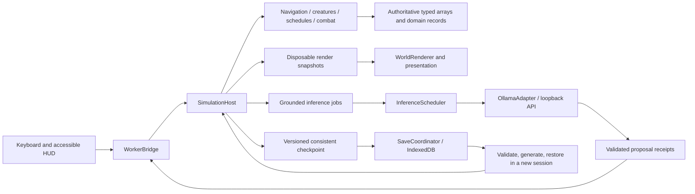

# Architecture and implementation guide

Read this alongside the [master plan](master_plan.md). Every source link below points to the implementation used by the playable game and the test harness.

## Ownership and dependency direction

The worker is the sole runtime owner of game state. The main thread does not own a competing physics or creature simulation. The renderer copies presentation coordinates from transferred snapshots, then returns their buffers. It never receives the authoritative creature arrays.

`src/domain` imports content and other domain modules. It does not import Pixi, network adapters, browser persistence, or DOM state. [The architecture check](../scripts/check-architecture.ts) enforces that boundary and rejects unseeded domain randomness. `GameBootstrap` is the composition root; it supplies adapters and manages browser lifecycle.

## Public interfaces

| Contract                         | Implementation and guarantees                                                                                                                                                                                                                   |
| -------------------------------- | ----------------------------------------------------------------------------------------------------------------------------------------------------------------------------------------------------------------------------------------------- |
| `SimulationHost`                 | [simulation.ts](../src/domain/simulation.ts): construct initialized state, `submit`, `step`/`advance`, `frame`, `terrain`, `snapshot`, `restore`, `dispose`. Headless and worker hosts use identical rules.                                     |
| `WorldCommand` / `CommandResult` | [contracts.ts](../src/domain/contracts.ts): validated discriminated payload, command ID, world session, issuer, explicit acceptance and message. No functions or executable scripts cross the boundary.                                         |
| `DomainEvent`                    | [agents.ts](../src/domain/agents.ts): committed event ID, simulation tick/day, position, subjects, importance, and factual description. Events are notifications, not an event-sourced database.                                                |
| `WorldQuery`                     | [query.ts](../src/domain/query.ts): observer-scoped facts, nearby entities, known destinations, gift eligibility, time/weather; returns data descriptions, not mutable stores.                                                                  |
| `NavigationService`              | [navigation.ts](../src/domain/navigation.ts): request, advance, result/take, cancel, invalidate, and connectivity checks. Explicit pending/found/unreachable states.                                                                            |
| `InferenceProvider`              | [inference.ts](../src/adapters/inference.ts): discover models, capability check, cancellable structured generation, token usage. Replace the adapter without giving models authority.                                                           |
| `SaveRepository`                 | [persistence.ts](../src/adapters/persistence.ts): checkpoint, restore, export, import. A snapshot contains all authoritative state, including memories and commitments.                                                                         |
| Worker protocol                  | [contracts.ts](../src/domain/contracts.ts), [worker host](../src/worker/simulation.worker.ts), [bridge](../src/adapters/worker-bridge.ts): init, commands/results, frames, checkpoints, restore, buffer recycle, disposal, and explicit errors. |

The `SimulationHost` constructor is the initialization contract rather than a separate partially initialized object. `submit` executes a serialized command phase on the owning thread; worker message callbacks cannot interleave with a running tick. Commands received during pause can only change explicitly allowed interaction/lifecycle state.

Actor revision checks belong to generated proposals; ordinary movement commands do not require every client frame to echo an actor revision. Inference jobs carry both actor and memory revisions. Restoring creates a new session, cancels old callbacks and uncommitted offers, and derives new paths.

## Values and storage

[values.ts](../src/domain/values.ts) defines distinct identifiers, positions, tile coordinates, ticks, days, elevation, normalized needs, elements, and configuration. `ItemId`, `SpeciesId`, inventory tuples, action unions, memory kinds, and content profiles live beside their owning subsystem.

Use checked construction at external boundaries. Numeric hot loops retain unboxed numbers; they do not allocate a class instance for every vector, need, or tile sample.

| Structure                  | Reason and bounds                                                                                                                                          |
| -------------------------- | ---------------------------------------------------------------------------------------------------------------------------------------------------------- |
| Layered world typed arrays | Biome, elevation, fluids, flags, resource type, quantity, climate, and timers have separate meanings. Index is `floor(y) * size + floor(x)`.               |
| Entity structure of arrays | Shared entity columns; stable uint32 IDs map to reusable slots. Capacity 2,048 wildlife plus 31 humans; initial population 1,031. ID reuse is forbidden.   |
| Small NPC domain records   | Thirty villagers need heterogeneous schedules, memories, relationships, and commitments; objects are clearer than forcing everything into numeric columns. |
| Uniform spatial grid       | Rebuilt periodically, with bounded candidate queries. Exact distance/ownership checks follow broad-phase lookup.                                           |
| Stable binary min heap     | Incremental A* frontiers and regrowth deadlines. Equal priorities preserve insertion order.                                                                |
| Maps and sets              | Bounded path cache, command deduplication, reservations, active reactions, profile lookup, and journal milestones.                                         |
| Ring buffers               | Event history and diagnostics remain bounded. Persistent milestones do not depend on retaining every event.                                                |
| Structured commitments     | Independent of lossy prose summaries; retain time, participants, location, status, and evidence.                                                           |

## Patterns and responsibilities

- **Ports and adapters:** isolate loopback networking, IndexedDB, WebGL, audio, and worker messaging. Domain tests run without those browser services.
- **Commands and events:** validate intent before mutation; publish receipts after committing. A well-formed JSON object is not authorization.
- **Composition over entity inheritance:** all living actors combine definitions and shared state columns; systems consume the columns they need. There is no `FireWaterWindCreature` inheritance tree.
- **State machines:** combat phases, creature modes, dialogue pause/staging, and commitment status have explicit transitions.
- **Utility selection:** need urgency selects goals; hysteresis and commitment intervals reduce oscillation. Safety/defeat interrupts override ordinary goals.
- **Scheduling and bounded work:** fixed ticks, staggered decisions, incremental navigation, reaction budgets, inference deadlines, and real-time request caps bound work.
- **Transactional persistence:** serialize a coherent worker snapshot; atomically rotate database checkpoints. Checksum verification detects accidental corruption, not malicious modification.
- **Presentation adaptation:** sprites, HUD, particles, and audio respond to snapshots/events. Cosmetic randomness cannot alter gameplay.

No dependency injection framework, global service locator, generic behavior-tree editor, full event sourcing, distributed agents, or custom rendering engine is introduced.

## Time, ordering, and lifecycle

One simulation tick performs deferred command receipts, time advancement, bounded navigation, player movement, detailed creature intentions/movement, NPC schedule movement, combat/interactions, slower needs/ecology/regrowth/social work, environmental reactions, and occasional inference job creation. Worker frames publish independently at approximately 10 Hz; Pixi interpolates and renders independently.

This ordering is explicit in `SimulationHost.step`. Navigation advances before new path requests so a new intention can wait until the next tick. Spatial occupancy is periodically rebuilt; all damage and care interactions apply exact current-distance checks after candidate lookup.

`FixedStepClock` discards paused elapsed time and caps catch-up to five steps per pump. Simulation time controls needs and daily rules. Rendering time controls interpolation/cosmetics. Real time controls inference deadlines and background rate limits. Hidden tabs acquire a separate pause token and never apply offline catch-up.

Shutdown aborts inference, rejects pending bridge requests, stops the worker, closes audio/storage, and releases renderer resources. No background loop continues a closed world.

## Persistence and compatibility

Generator, content, and save versions are independent. Terrain is reconstructed from the seed/version, then saved changes are applied. Dynamic state includes creature columns, NPC records, player/inventory, timers, random streams, combat, dropped items, markers, journal, memories, and commitments.

Paths, rendering caches, resource indexes, spatial indexes, pause tokens, in-flight requests, and unfinished dialogue offers are derived/transient. Restoring recomputes these; it does not promise bit-identical future movement relative to an uninterrupted run with partially completed path searches. Same seed/version generation and deterministic calculations remain reproducible.

Never change the meaning of terrain generation while silently retaining the generator version for released saves. Migration rejects unknown future versions and invalid ownership/array shapes. Save v3/content v2 retain generator v1. The frozen legacy schema and captured real v2 fixture verify migration into shared bodies, healthy newly introduced needs, protected/downed defeat handling and unchanged social progress. See [entity compatibility](unified_entities.md#migration-and-lifecycle).

## Performance and tests

Complexity budgets are in each phase document. [Verification](verification.md) separates Node simulation timings from browser/GPU costs and live-model latency. A worker prevents main-thread contention; it does not make unbounded work acceptable.

Every phase has behavior tests. Browser journeys exercise the actual worker, WebGL renderer, native dialog controls, IndexedDB, model handshake, deferred actions, and resume. The 28-day soak checks bounded identities, all seasons, population recovery, finite values, complete checkpoint validation, and restore during long-running ecology.

## Unified actor extension

[Unified entities](unified_entities.md) specifies the shared `EntityStore`, accessor adapters, species/affinity/controller separation, five-need survival, forced sleep, Nature, generic combat, finite supplies, carrion and bounded replacement. Player/NPC records do not persist duplicate positions or HP. A disposable pooled packet contains separate Float32 presentation and Uint32 identity views. A stable ID is resolved before touching a storage slot; an old target cannot bind to a replacement born into the same slot.

At safe sleep acceleration the worker repeats ordinary fixed ticks, stopping after the first tick that revokes acceleration. All world systems advance. Network deadlines/rate limits remain real-time, and background starts/proposal commits wait. After restore acceleration is 1× and paths/tasks/tiers are recomputed.
