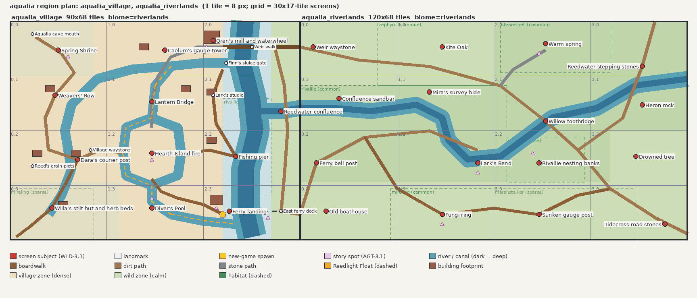

# Region bible: Aqualia (WLD-4.1)

Machine-readable plan: [`art/source/world/regions/aqualia.plan.json`](../../../art/source/world/regions/aqualia.plan.json).
`worldforge plan check aqualia` holds every map to it. Map contract:
[`world_schema.json`](../../../art/source/world/spec/world_schema.json). This bible is
doctrine (DOC-1). Change it only through a director-approved proposal (DOC-5).

_Sketch rendered from the plan by `worldforge plan render aqualia`. Red dots mark the
subject of each screen. Pink triangles mark story spots. The yellow star is the new-game
spawn. The dashed gold line is the Reedlight Float._

## AQ-1 Identity

- **Feel:** a canal village on the Wend at dawn (PIL-1). Water is everywhere and always
  moving: canals, a millrace, a ferry, a dive pool. People live along the water. Their
  doors open onto boardwalks, not roads.
- **Look (ART-13, ART-4.6):** timber boardwalks, teal slate roofs, reeds, lily pads,
  lanterns, rope and nets, willow trees. The palette leans teal, navy, reed, timber and
  sand.
- **Sound (AUD-3.2, AMB-1):** 6/8 harp over a soft pulse, major with a raised 4th. By day,
  dragonflies, fish ripples and laundry; by night, lantern flicker, frogs and fireflies.
- **Levels:** `aqualia_village` (90×68 tiles, 3×4 screens) and `aqualia_riverlands`
  (120×68, 4×4 screens), side by side. The Wend runs through the east third of the
  village. The Riverlands lie across it to the east.

## AQ-2 Landmarks

| Landmark                                     | Where (level, tile)        | Who / why                                                                   |
| -------------------------------------------- | -------------------------- | --------------------------------------------------------------------------- |
| Hearth Island fire                           | village (44, 41)           | The square: communal fire, well, notice board; reached by four bridges      |
| Ferry landing                                | village (68, 59)           | Neris's ferry; the arrival point                                            |
| Diver's Pool                                 | village (44, 58)           | Marina's dive platform; the Mill Canal widens here                          |
| Lantern Bridge                               | village (44, 25)           | Arched stone bridge over the Mill Canal; lanterns on both parapets          |
| Oren's mill and waterwheel                   | village (63, 6)            | Oren's home and workshop; the wheel turns on the millrace                   |
| Finn's sluice gate                           | village (67, 13)           | Where the Mill Canal leaves the Wend                                        |
| Caelum's gauge tower                         | village (48, 9)            | Canal basin and water gauge; Caelum's work                                  |
| Weir walk                                    | village (75, 8)            | Footway over the weir: the northern crossing to the Riverlands              |
| Spring Shrine                                | village (15, 9)            | On the e1 hill; the cave mouth (`cave:aqualia`) sits in the e2 ridge behind |
| Weavers' Row                                 | village (14, 23)           | Marina's porch, reed drying racks, laundry lines                            |
| Dara's courier post, village waystone        | village (21, 43)           | Routes out; the start of the waystone chain                                 |
| Willa's stilt hut and herb beds              | village (13, 58)           | Wetland edge; the Reedhaven road leaves here                                |
| Fishing pier, Lark's studio                  | village (70, 42), (63, 23) | Riverside life on the Wend                                                  |
| Reedwater confluence                         | village (84, 28)           | Seen across the Wend from the riverside walk                                |
| Lark's Bend                                  | riverlands (55, 44)        | The U-bend under an old willow that Lark paints every season                |
| Rivallie nesting banks                       | riverlands (74, 44)        | Mira's survey site; the densest Rivallie habitat                            |
| Warm spring                                  | riverlands (76, 7)         | A steaming pool on the e1 terrace; steamshell bask on its rim               |
| Kite Oak, Willow footbridge, Ferry bell post | riverlands                 | Meadow landmark; the road crossing; the bell that calls the ferry           |
| Fungi ring, Sunken gauge post, Drowned tree  | riverlands                 | The south fen: mireling hollow, Caelum's grandmother's gauge, a dead tree   |

## AQ-3 Routes

- **The arrival (WLD-3.2):**
  - The new game starts on the ferry landing at dawn.
  - The boardwalk curves west along the pool outflow.
  - The first thing it reveals is Diver's Pool, with Hearth Island's fire glowing beyond
    it.
  - Lanterns are still lit (AMB-3).
- **Canals (WLD-3.5):** canals are 3 tiles wide with boardwalk on at least one bank, and
  every path crossing over water is a bridge.
  - The **Mill Canal** runs from the sluice to the basin, splits around Hearth Island,
    passes through Diver's Pool and rejoins the Wend south of the ferry.
  - The **West Cut** loops from the basin past Weavers' Row and the courier post into
    Willa's wetland.
- **Crossings of the Wend:** the weir walk (north, always open) and the ferry (south,
  Neris, called by the bell post on the far bank). The ferry is a service, not a path.
- **Reedlight Float (LIF-4.2):** lantern boats at dusk go from the basin, around Hearth
  Island and through the pool, then out to the Wend. Watch from the south bridge
  (`reedlight-view`).
- **Riverlands roads:**
  - The east road runs from the weir walk over the willow footbridge to Tidecross, leaving
    south-east.
  - A meadow path runs from the ferry bell to Lark's Bend.
  - The fen boardwalk crosses the south.
  - An upper trail runs north past the stepping stones.
- **Planned exits** (not yet authored): the Reedhaven road leaves the village south-west,
  and the Tidecross road leaves the Riverlands south-east. Both end at the level edge
  until those regions get bibles.

## AQ-4 Story spots (AGT-3.1, AGT-6.1)

Each spot frames its subject inside a villager's 12×7-tile sight window:

- **Village:**
  - `dawn-arrival` (ferry landing)
  - `hearth-circle` (the fire)
  - `reedlight-view` (Diver's Pool)
  - `mill-at-dawn`
  - `shrine-overlook`
  - `ferry-at-dusk`: Lark paints the ferry.
- **Riverlands:**
  - `larks-bend-view`
  - `nesting-watch`
  - `spring-steam`
  - `fungi-night`

## AQ-5 Creature habitats

| Species      | Where                                                                                    | Density                     |
| ------------ | ---------------------------------------------------------------------------------------- | --------------------------- |
| rivallie     | Riverlands nesting banks; Reedwater meanders; the Wend in the village (seen, not herded) | dense / common / sparse     |
| steamshell   | Warm-spring terrace                                                                      | common                      |
| zephyrit     | North meadow around the Kite Oak                                                         | common                      |
| mireling     | South fen around the fungi ring; Willa's wetland                                         | common / sparse             |
| marshstalker | Deep fen                                                                                 | sparse, dusk and night only |

Fights happen in the Riverlands. Their zones are `calm` or `medium` density, so actors and
telegraphs read clearly (WLD-3.3, PIL-2). The village has no hostile habitat.

## AQ-6 Screens

Every screen has one subject (WLD-3.1). Every village screen has at least three depth
layers (WLD-3.4): foreground canopy or roofs, mid-ground actors and boardwalks, and
background water. The full list, with notes for each screen, is in the plan's `screens`.

| Village | col 0         | col 1          | col 2                     |
| ------- | ------------- | -------------- | ------------------------- |
| row 0   | Spring Shrine | gauge tower    | mill                      |
| row 1   | Weavers' Row  | Lantern Bridge | Reedwater confluence      |
| row 2   | courier post  | Hearth Island  | fishing pier              |
| row 3   | herb wetland  | Diver's Pool   | **ferry landing** (spawn) |

| Riverlands | col 0              | col 1       | col 2             | col 3            |
| ---------- | ------------------ | ----------- | ----------------- | ---------------- |
| row 0      | weir waystone      | Kite Oak    | warm spring       | stepping stones  |
| row 1      | confluence sandbar | survey hide | willow footbridge | heron rock       |
| row 2      | ferry bell         | Lark's Bend | nesting banks     | drowned tree     |
| row 3      | old boathouse      | fungi ring  | sunken gauge      | Tidecross stones |

## AQ-7 Authoring rules for this region (blender agent, worldforge)

1. **Pass order:**
   1. ground
   2. water (rivers, canals, pool), checked against the plan routes' widths
   3. elevation (shrine hill, ridge, warm terrace) with ramps
   4. paths and bridges
   5. collision: footprints, cliff edges, deep-water rules from the schema
   6. buildings and gameplay entities
   7. landmarks
   8. decoration
   9. ambience and light entities

   Render and look after every pass.

2. Village density is `dense`: boardwalk clutter, nets, barrels, planters, laundry.
   Riverlands is `calm` to `medium`: readable ground first.
3. Lanterns go on every bridge, the ferry dock, house doors and Hearth Island. Each is a
   `LightSource` entity (AMB-3.2); the light is never baked into the art.
4. A landmark may move only within its plan tolerance. To move it further, ask the
   director (proposal).
5. Don't edit `.ldtk` by hand (WLD-4.3). Don't invent canals or crossings that aren't in
   the plan: the composition is decided here.
