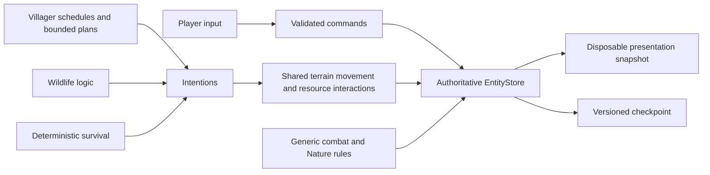

# Unified entities, physiology, Nature, and food webs

This is the implemented content-v2/save-v3 specification. It supersedes the old care exemption and automatic wildlife revival rules. [Master plan](master_plan.md), [source](../src/domain/entities.ts), and [behavioral acceptance tests](../tests/entities.test.ts) describe the same implementation.

## Ownership and composition

An **Entity** is any living actor. A **Human** is the player or an authored villager. Biological species, elemental affinity, controller, diet, and relationships have separate meanings. Humans share the biological species `human`; changing hometown does not permit human consumption.

`EntityStore` exclusively stores bodies: position/velocity/facing, current HP, XP/level, stamina, five needs, sleep obligations, ownership, species/affinity, and behavior mode. Immutable species definitions provide base maximum HP, attack, defense, speed, eligible foods, prey species, bathing medium, and moves. Maximum HP is base HP plus five per earned level. Wellbeing changes effectiveness, never earned XP or durable maximum HP.

NPC records retain profile references, schedules, affinity, relationships, memory, commitments, and a companion entity ID. Player control retains origin, dash/invulnerability deadlines, and an attack record. `bindBody` supplies accessor adapters for ergonomic position/health access; those accessors read and write the same numeric columns. They are not a second body. Saves omit accessor fields from control/social records.

The existing `CreatureStateStore` export is a compatibility alias of `EntityStore` for nonhuman systems. There is only one store instance in a host. Wildlife occupies a reusable slot range; 31 permanent human slots follow it. A slot is an allocation detail. ID-to-slot lookup uses a map, and monotonically allocated uint32 IDs survive save/load. Wildlife retirement frees storage without freeing an identity. Human IDs remain 0–30 for the authored cast; migration assigns old wildlife identity `i` the persistent ID `100+i` once.

Render transport puts Float32 presentation columns and a separate Uint32 ID view in one pooled disposable buffer. Float32 fields never encode persistent IDs. Transferring that buffer cannot detach the authoritative body columns.

## Public components and contracts

| Component                                                        | Responsibility and owned state                                                         | Interface, invariants, lifecycle, and failures                                                                                                                                                                                                                                                                                                                                         |
| ---------------------------------------------------------------- | -------------------------------------------------------------------------------------- | -------------------------------------------------------------------------------------------------------------------------------------------------------------------------------------------------------------------------------------------------------------------------------------------------------------------------------------------------------------------------------------- |
| [`EntityStore`](../src/domain/entities.ts)                       | Shared numeric columns, identity lookup, Nature and dietary overrides                  | `spawn`, `spawnHuman`, `retire`, `slot`/`require`, `id`, `slots`, `definition`, `diet`, `wellbeing`, `snapshot`, `restore`, `validate`. Capacity is 2,048 wildlife plus 31 humans. IDs never identify a different body. Unknown IDs fail lookup; exhausted capacity fails before spawn. Restore validates before publication.                                                          |
| `NaturePolicy`, `AggressionRule`                                 | Durable response and territorial target/radius values                                  | Response is avoid or retaliate; aggression targets biological species or nonhumans. Runtime rules distinguish aggression from hunger. Policies are copied on assignment and persisted.                                                                                                                                                                                                 |
| `NatureRules`                                                    | Stateless attack/hunt/consumption predicates                                           | `canAttack` checks distinct living combatants and waking attacker; `canHunt` additionally checks edible unbonded wildlife and different species; `canConsume` checks diet, provenance, remaining quantity and no cannibalism. Player input is not restricted by AI temperament.                                                                                                        |
| `SleepSystem`                                                    | Pure transitions over body-owned sleep/rest fields                                     | `begin`, `interrupt`, `update`, `metabolism`. Forced obligation survives interruptions and checkpoints. Sleeping cannot revive a corpse or downed body.                                                                                                                                                                                                                                |
| [`NeedsSystem`](../src/domain/creatures.ts)                      | Slow physiological updates and recoverable care                                        | `advance` iterates every living body, including humans and NPC companions. No care exemptions. Starvation reduces HP; protected/downed bodies recover on a deadline; dead wildlife does not. Returns broken player bonds for committed events.                                                                                                                                         |
| [`SurvivalController`](../src/domain/survival.ts)                | Deterministic need intentions, paths, retry deadlines                                  | `decide`, `active`, `move`, `clear`. Selects actual forage, carrion, finite pantry, freshwater, compatible bath or rest destination. Resources are reserved by entity ID. Consumes at source; never creates NPC inventories. Navigation failures have cooldowns, tasks expire, and current terrain is checked at movement/interaction. Paths/tasks are derived and cleared on restore. |
| [`ResourceStore`](../src/domain/resources.ts) additions          | Finite pantries, carcasses, species-carrying dropped food                              | `hasSupply`, `consumeSupply`, `replenish`, `addCarrion`, `takeCarrion`. Failed transactions preserve source quantity. Harvest and direct consumption decrement the same carrion servings. Supplies and carrion are saved with world state.                                                                                                                                             |
| `Carrion`                                                        | Dead-source ID, species, position, remaining servings and expiry                       | Up to four servings per death. Only retired unbonded wildlife produces it. Empty/expired bodies are removed during bounded maintenance. No actor recovery timer can also revive this identity.                                                                                                                                                                                         |
| `EcologyService`                                                 | Pending replacements, target and birth/death counters                                  | `resolveDeaths` commits retirement once; `replenish` tries at most one birth per second after 120–240 seconds. Requires available population space, species target, suitable terrain, food/prey and local carrying capacity. Failed attempts retain the pending vacancy.                                                                                                               |
| [`CombatSystem`](../src/domain/combat.ts) additions              | Stable-ID pursuits, attack records, cooldowns, hunt reservations and assault cooldowns | `advance`, `active`, `danger`, `pruneRetired`, snapshot/restore. Every pair uses the same damage/element/defense rules. Generic tactical attacks use seven windup, three active and sixteen recovery ticks, plus species cooldowns. Sleep, death, range and hit deduplication are checked during execution.                                                                            |
| `Pursuit`                                                        | Target ID, cause and expiry                                                            | Hunt, retaliation, territory, duel and assistance remain distinct. Avoiding defenders flee; retaliating defenders attack. Pursuits disengage beyond twelve tiles or their time budget. Failed hunts wait before reacquisition.                                                                                                                                                         |
| [`GameSaveSchema` / `migrateSave`](../src/domain/save-schema.ts) | Shared boundary schemas and v1/v2 upgrade                                              | Reject duplicate IDs/slots, wrong permanent bonds, invalid physiology, missing food provenance, living carrion, invalid pursuits and future versions. Validation precedes replacing a running worker. Legacy schema is retained separately in [legacy-save.ts](../src/domain/legacy-save.ts).                                                                                          |

## Needs and sleep rules

All five needs are high-is-good values in `[0,1]`: Food (satiety), Water (hydration), Recreation, Cleanliness and Rest. Hunger and thirst are derived urgency values, not separately stored opposing meters. Wellbeing is their arithmetic mean and keeps the original quartile tiers and .25 movement floor.

| Calculation                    | Reference value                                           |
| ------------------------------ | --------------------------------------------------------- |
| Awake Rest loss                | `dt / 960`, equivalent to sixteen in-game hours from full |
| Sleeping Rest gain             | `dt / 480`, equivalent to eight in-game hours from empty  |
| Awake food/water multiplier    | `1 + .25 * (1 - Rest)`                                    |
| Sleeping food/water multiplier | `.5`                                                      |
| Base food loss                 | `dt / 1800` before the multiplier                         |
| Base water loss                | `dt / 1400` before the multiplier                         |
| Cleanliness loss               | `dt / 2100`                                               |
| Autonomous early rest          | Below .20 Rest; humans seek authored homes                |
| Forced release                 | At least .50 Rest, regardless of earlier partial recovery |
| Voluntary target               | Full Rest                                                 |
| Critical wake                  | Food or Water below .08; immediate threat or damage       |

Physiology advances once per simulation second, with clamping. Rest exhaustion latches a forced obligation at the update that reaches zero. Normal movement and attacks are unavailable while asleep. An emergency wakes the body, retains the obligation, and allows survival actions. The safe interval before resuming forced rest is at least five seconds. Downed recovery is a separate transition and never uses sleeping as resurrection.

Autonomous survival overrides schedules, following and model plans. NPC companions can leave formation to eat, drink, wash or rest. Villagers retain no personal inventories. Human preferences/restrictions filter and rank the species diet; they are persisted separately from elemental affinity.

The player manages food and rest through carried items and service controls. Dialogue supplies recreation. The HUD warns about fatigue, displays all five needs, and offers Rest, Wake, and 8× sleep. Villager inspection displays the same meters. A forced sleeper cannot manually wake before the obligation is fulfilled; emergencies remain able to wake them.

## Acceleration and asynchronous work

The worker's ordinary 30-Hz clock executes up to eight normal ticks per clock step while safe sleeping is accelerated. Calendar, all needs, distant hunts, crops, schedules, combat and replacement deadlines advance through those ticks. There is no calendar jump or off-screen exemption.

After each tick, waking, local combat danger, damage, critical player needs or pause revokes acceleration. The current loop checks revocation before its next extra tick. Hidden tabs and menus reset acceleration and discard elapsed paused time. Acceleration is transient and always resumes at 1× after restore.

The inference scheduler retains its real-time budget. Background starts are deferred while accelerating; already returned background proposals wait for ordinary time. Deterministic survival, schedules and combat continue without waiting for a model.

## Finite food and predation

Three capitals and six outposts have accessible service points. Pantries begin with finite authored stock. Maintenance transfers actual nearby forage units into stock, with a per-item cap; depleted forage uses normal seasonal regrowth. Water springs are renewable geographic sources. Gifts withdraw finite settlement stock as well as consuming the authored daily gift allowance. There is no personal NPC backpack or unbounded food creation.

The original six plant diets remain intact. Two new species reuse the corresponding hybrid move parameters with distinct presentation:

| Species      | Elements     | Edible wildlife                  | HP / ATK / DEF / SPD |
| ------------ | ------------ | -------------------------------- | -------------------- |
| Bramblefang  | Fire / Wind  | Zephyrit, Rivallie, Marshstalker | 84 / 14 / 9 / 3.8    |
| Marshstalker | Water / Wind | Cindermoth, Mireling             | 68 / 12 / 7 / 3.5    |

Hunters acquire prey within six tiles below .40 Food. Hunger remains active until Food exceeds .80 and its latch persists across saves. A nearby finite meal takes priority over starting another hunt; predators continue feeding toward .80. Territorial targets need no hunger and are not automatically edible. Hunt reservations expire, pursuit is capped at twenty simulation seconds, and unsuccessful hunts wait five seconds before retrying. Movement always respects terrain collision; an obstructed chase can fail rather than teleporting or hanging indefinitely.

Fresh worlds begin with about four percent predators, equally split, within the 1,000-nonhuman target. Replacement quotas cap each predator at two percent; herbivore capacity divides the remainder. Local capacity rejects a birth with 24 conspecifics already within sixteen tiles; predators require at least two living, edible, unbonded nearby prey, and herbivores require available forage. Replacements introduce new individuals rather than reviving consumed IDs. Pending vacancies permit recovery without unbounded reproduction or permanent identity reuse.

`meat` and processed `meal` carry every originating animal species. The two-slot recipe normalizes ingredient order and unions provenance. Drops, pickups, care, direct consumption and save validation preserve/check it. Same-species attacks are allowed; raw or processed same-species consumption is rejected. Humans and companions never create food.

## Social violence and encounters

Player attacks can hit villagers. Humans are protected from consumption and enter recoverable downed/rescue behavior at defeat. A first assault in a 90-second victim window applies a bounded ten-point affinity loss and produces an attributable witnessed event. The victim and nearby villagers record it with event provenance. Passive victims flee and guard without attacking; Neutral victims retaliate. Active combat prevents opening dialogue.

Assaults and attacks on NPC companions outside their own agreed duel grant no XP; challenging one villager does not authorize rewards from other companions. Autonomous hunts grant food, not XP. The daily rule is reserved for agreed NPC partner duels and is consumed when the duel begins. Both partners and the villager must be nearby and ready. A dialogue battle request releases its dialogue pause before validating the battle; another pause owner still prevents starting it. Player-versus-wildlife encounter rewards remain bounded and are awarded once.

## Migration and lifecycle

Save v3/content v2 retain generator v1. Migration reconstructs one shared body per old actor and preserves terrain deltas, current positions, inventory/serial, HP, XP/levels, bonds, relationships, memories and commitments. New needs start healthy. Structured creature references become entity references; historical event/source IDs and prose are retained. Existing defeated wildlife receives a downed obligation and recovers once, rather than retroactively becoming carrion. Old populations remain intact; predators enter through subsequent ordinary vacancies.

World restore validates the entire incoming snapshot, replaces body state, restores control/social metadata and persistent ecology, then clears derived spatial/navigation/survival work. Recomputed tier assignments can differ from old transient tiers. Session boundaries still reject obsolete inference callbacks. No progression occurs while the game is closed.

## Complexity, budgets, and verification

Body lookup and damage math are O(1); body snapshots/needs/spatial rebuilds are O(N). Diet/Nature operations inspect small bounded content lists. Survival candidates use local resource buckets; navigation shares at most 800 expansions per tick, 64 active searches, 128 cached paths, and a 16,000-expansion per-search limit. Tactical acquisition is staggered to once per second, uses bounded spatial candidates and reservations, and caps each chase. Replacement work permits 64 candidate placements and one accepted birth per second; local capacity is checked only for viable candidates.

The near simulation tier still caps ordinary detailed wildlife at 128. Distant survival uses coarse movement, while active combat retains its tick windows so accelerated/off-screen hunts do not skip outcomes. Thirty human controllers are always available. Rendering quality and cosmetic particles do not alter any rule above.

[Entity tests](../tests/entities.test.ts) cover shared state, integer-safe identity transport, all five needs, sleep latching/interruption, finite NPC meals, Nature, cannibalism, hunting, assault memory, carrion, and the captured real v2 migration fixture. [Browser journeys](../tests/browser/journey.spec.ts) exercise the worker, HUD, controls, and public save import. [Benchmark](../scripts/benchmark.ts) measures 1,031 living bodies and dense nearby scenes; the [28-day soak](../scripts/soak.ts) validates every season, all eight species, population bounds, checkpoints and restore. Actual measured results belong in [verification](verification.md), not in unmeasured throughput promises.
